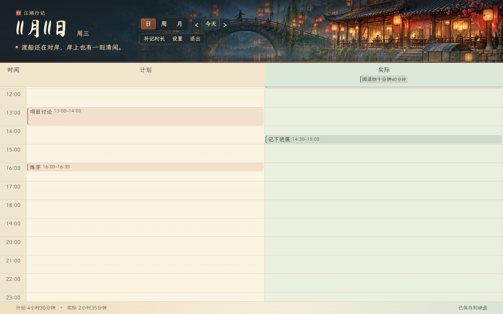
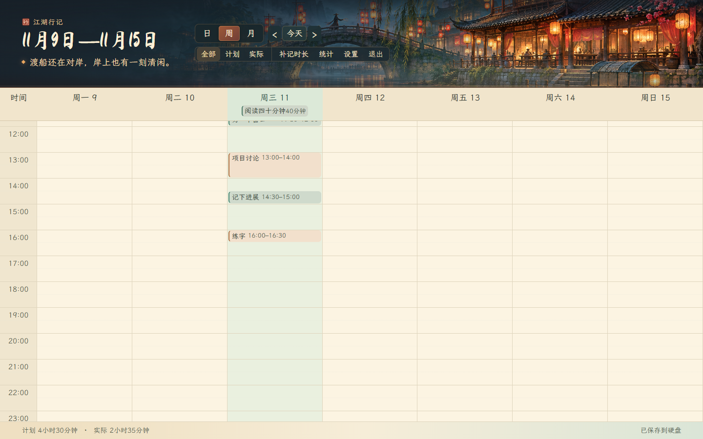

# 江湖行记 · Jianghu Journal

**把一天的来去，落在一张江湖行程笺上。** 
*A quiet, offline-first time journal for planning a day and remembering how it went.*

[Download for Windows](#download--下载) · [中文说明](#中文) · [English guide](#english)

江湖行记 is a small personal planner with three views—**day, week, and month**—and a simple rule: click the time you mean and start typing. It is designed for people who want to plan ahead, record what actually happened, and review their time without signing up for a service.

Screenshots below use synthetic demo entries. They contain no personal journal data.

## At a glance

### Day

Plan and actual time sit side by side. Click an empty time to write, or drag to choose a duration.

### Week

See the shape of the week at once. Click a day to jump into its daily record.

### Month

Each date stays readable when it is busy: the month shows a short preview, and a click opens that day's complete schedule in a centered, scrollable sheet.

Click a date or its count to open the complete list in the center of the window:

## Download · 下载

1. Download **<code>Jianghu-Journal-v1.0.0-windows-amd64.zip</code>** from [Releases](https://github.com/Charlielin-Fan/jianghu-journal/releases/latest).
2. Extract the whole <code>江湖行记</code> folder to a writable location. A removable drive works too.
3. Double-click <code>江湖行记.exe</code>. If the WebView2 Runtime is unavailable, the launcher opens the local journal in your default browser instead.

The release is an unsigned Windows application. Windows SmartScreen may show its first-run warning; verify that the download came from this repository before choosing to run it.

## A quick first day

- **Day:** Click a blank time and type a title. Press Enter to save. The default block is 30 minutes; drag to set a longer or shorter span.
- **Week:** Click or drag in a day column to add a plan. Switch to **Actual** to record what happened.
- **Month:** Point at the lower edge of a date cell to reveal its time ruler, then click the time. Click a date—or <code>+N</code>—to read and edit the complete day.
- **Review:** Use weekly or monthly statistics to compare planned time, actual time, and categories.
- **Back up:** Open Settings to export or restore a JSON backup.

The full quick guide is also available offline in [使用说明.txt](使用说明.txt).

## Privacy & data · 隐私与数据

- No account, cloud service, telemetry, or automatic activity tracking.
- Journal data is saved beside the executable in <code>数据/行记.json</code>; a previous copy is kept as an automatic backup. Move the whole folder to carry your journal to another computer.
- While open, the interface talks only to a temporary <code>127.0.0.1</code> address on your own computer. It does not expose the journal to your network.
- The app takes a local file lock so two instances do not write to the same journal at once. Close it before ejecting a removable drive.
- **Do not commit or share your <code>数据</code> folder, <code>行记.json</code>, backups, or exports.** The repository ignores these paths; see [<code>.gitignore</code>](.gitignore).

## Build and test

The application is a native Windows executable with an embedded HTML/CSS/JS interface. The binary needs Windows 10/11 x64 and the Microsoft Edge WebView2 Runtime for its desktop window. A recent Edge or Chrome browser is used for the browser fallback.

Install [Go 1.24 or newer](https://go.dev/dl/), then run in PowerShell:

For a source checkout, install [Git LFS](https://git-lfs.com/) first so the bundled font files are downloaded instead of their small pointer files.

~~~powershell
go test ./...
go build -trimpath -ldflags="-H windowsgui -s -w" -o .\江湖行记.exe .
~~~

For the browser, dense-month, and removable-folder checks:

~~~powershell
py -m pip install -r requirements-test.txt
py -m playwright install chromium
py .\qa.py .\江湖行记.exe --usb $env:TEMP
~~~

For native-window and motion checks, run <code>py .\qa_desktop.py .\江湖行记.exe</code> on a Windows desktop. These QA scripts generate synthetic entries in temporary folders; they do not need your journal data.

The Windows CI workflow runs <code>go test ./...</code> and <code>go vet ./...</code> on each push and pull request.

## License & credits

The project source and original project artwork are available under the [MIT License](LICENSE). Bundled fonts and Go components retain their own licenses; attribution and full notices are in [NOTICE.md](NOTICE.md), [字体许可.txt](字体许可.txt), [组件许可.txt](组件许可.txt), and the license files beside the bundled fonts.

The visual theme is wuxia-inspired and independently made. 江湖行记 is not affiliated with or endorsed by any game, publisher, or franchise.

---

## 中文

江湖行记是一款轻量的个人时间管理工具。日、周、月三个视图共用同一份行记：**点中一个时段，就能直接开始记；不用先填年月日。** 适合先安排，再回看这一天实际走过的路。

上方截图使用测试专用的虚构行程，没有包含任何个人行记。

### 下载与启动

1. 在 [Releases](https://github.com/Charlielin-Fan/jianghu-journal/releases/latest) 下载 **<code>Jianghu-Journal-v1.0.0-windows-amd64.zip</code>**。
2. 将整个「江湖行记」文件夹解压到可写入的位置；也可以放在移动硬盘中。
3. 双击 <code>江湖行记.exe</code>。如果电脑没有 WebView2 运行时，程序会改用默认浏览器打开本机行记。

首次运行时，Windows SmartScreen 可能提示这是未签名程序。请先核对下载来自本仓库，再决定是否运行。

### 日常使用

- **日视图：** 点击空白时段，直接输入事项并回车保存。默认 30 分钟；拖动时段可以调整起止时间。计划与实际并排查看。
- **周视图：** 在某一天的时间栏点击或拖动来添加计划，切换到「实际」补记真实发生的事项。
- **月视图：** 鼠标移到日期格底部会出现时间尺，点一下就能从对应时段开始记录。每格显示简短预览；点日期或「+N 项」会在屏幕中央打开当天完整日程，查看后关闭即可回到原来的月历位置。
- **统计复盘：** 周、月视图可以对比计划、实际与分类；点击统计中的某天可进入日视图。
- **备份恢复：** 在「设置」中导出或恢复 JSON 备份。

完整的离线操作说明见 [使用说明.txt](使用说明.txt)。

### 隐私与数据

- 不需要账号；没有云端同步、遥测或自动行为追踪。
- 行记保存在程序旁的 <code>数据/行记.json</code>，程序会保留上一版自动备份。换电脑时，请把整个文件夹一起移动。
- 运行期间，界面只连接本机的临时 <code>127.0.0.1</code> 地址，不向局域网公开行记。
- 同一份数据同一时间只允许一个程序实例写入。拔移动硬盘前请先关闭程序。
- **不要把 <code>数据</code> 文件夹、<code>行记.json</code>、备份或导出文件提交到 GitHub。** 仓库的 [<code>.gitignore</code>](.gitignore) 已排除这些数据路径。

### 构建与测试

程序是 Windows 原生桌面入口，界面资源已嵌入可执行文件。运行桌面窗口需要 Windows 10/11 64 位系统与 Microsoft Edge WebView2 Runtime；浏览器回退模式使用新版 Edge 或 Chrome。

安装 [Go 1.24 或更新版本](https://go.dev/dl/)，在 PowerShell 中运行：

从源码构建前，请先安装 [Git LFS](https://git-lfs.com/)，以便下载完整字体文件，而不是只有指针文件。

~~~powershell
go test ./...
go build -trimpath -ldflags="-H windowsgui -s -w" -o .\江湖行记.exe .
~~~

运行浏览器、密集月历及移动文件夹测试：

~~~powershell
py -m pip install -r requirements-test.txt
py -m playwright install chromium
py .\qa.py .\江湖行记.exe --usb $env:TEMP
~~~

运行桌面窗口及动效测试：<code>py .\qa_desktop.py .\江湖行记.exe</code>。测试会在临时目录里写入虚构数据，不需要也不会读取你的行记。

GitHub Actions 会在每次推送和拉取请求时执行 Go 单元测试与 <code>go vet</code>。

### 版权与致谢

项目源码及原创项目美术按 [MIT 许可证](LICENSE)发布。随程序分发的字体与 Go 组件各自保留原有许可证；著作权声明和完整许可文本见 [NOTICE.md](NOTICE.md)、[字体许可.txt](字体许可.txt)、[组件许可.txt](组件许可.txt) 和字体目录内的许可证文件。

本项目采用独立创作的武侠主题视觉设计，与任何游戏、发行商或相关系列均无关联或背书关系。
